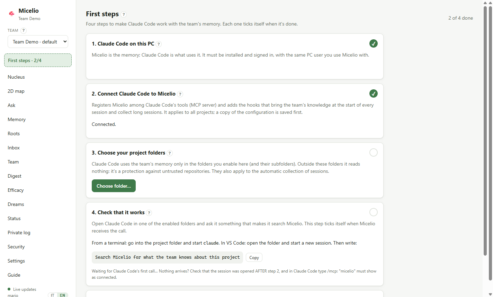

[Italiano](../guida-utente.md) | **English**

# User guide

Micelio is your team's shared memory, designed for AI assistants. Each colleague runs a **node** on their own machine. Nodes sync with each other over the internet without a central server, and each one holds a full copy of the team's knowledge.

Knowledge comes in two ways: explicit saves and automatic collection from Claude Code sessions in the projects you enable. Before it reaches your colleagues, every piece of content goes through a **privacy filter**.

## Getting started

From installation to Claude Code's first answer with the team's memory, in six steps. The app guides you: after creating the team it opens **First steps**, which ticks every step by itself once it's done.

**You need:** [Claude Code](https://code.claude.com/docs/en/setup) installed and signed in, on the same PC and **with the same user** you'll use Micelio with. Micelio uses your Claude subscription: no API key.



### 1. Install Micelio

Download the package from the [latest release](https://github.com/salvatorestracquadanio86/micelio-second-brain/releases/latest):
- **Windows**: `Micelio-Setup-<version>.exe`. No administrator rights needed. The installer isn't signed: if Windows shows "Windows protected your PC", choose **More info → Run anyway**. At the end Micelio opens by itself.
- **Linux**: `Micelio-<version>-x86_64.AppImage` (any distribution: make it executable and run it) or `micelio_<version>_amd64.deb` (`sudo apt install ./micelio_<version>_amd64.deb`).

Micelio stays in the notification area even when you close the window: it must stay on for colleagues to send you knowledge and for Claude Code to use it.

### 2. Create the team, or join a colleague's

At first launch choose:
- **Create a new team**: if you're the first. Give the team a name and your own name, visible to colleagues. You become admin.
- **I have an invite**: if a colleague sent you an invite code (they create it in **Team → Invite a colleague**). Paste the code and wait for their Micelio to let you in: a few seconds if their PC is on.

Right after, **First steps** opens.

### 3. Connect Claude Code

In First steps press **Connect Claude Code**. Micelio joins Claude Code's tools (MCP server), and Claude Code receives the team's knowledge at the start of every session. It applies to all your projects; before touching Claude Code's configuration, Micelio saves a copy of it.

**Then close and reopen the Claude Code sessions already open** (in VS Code: reload the window). Claude Code reads its tools only at startup.

### 4. Choose your project folders

Press **Choose folder…** and pick the folder of every project you work on with the team, for example `C:\SourceCode\project-name` (subfolders count too; you can pick the folder that contains them all).

It's the step people forget most: **Claude Code uses the team's memory only in these folders.** Outside them it reads nothing, for safety, and what it saves ends up in the Inbox instead of reaching the team.

### 5. Check that it works

Open Claude Code in one of the enabled folders (from a terminal: go into the folder and start `claude`; in VS Code: open the folder and start a new session) and write:

> Search Micelio for what the team knows about this project

In First steps, "Check that it works" ticks by itself when Micelio receives the call. With a new team the memory is empty: the answer will be that there's nothing yet, and that's right. Try saving too: *"remember that for this project we use …"*. The memory shows up in the **Memory** page.

### 6. Invite your colleagues

In **Team → Invite a colleague** create a code and send it to the colleague: it's a secret, for them only. They install Micelio, choose **I have an invite** and follow the same First steps.

### If something goes wrong

| What you see | What to do |
|---|---|
| "Claude Code isn't installed, or Micelio can't find it" | Install it from the [official page](https://code.claude.com/docs/en/setup), open it once, sign in, then **Check again** |
| "This PC user has never opened it" | Claude Code is used with another Windows user (for example an administrator account): it will never see Micelio. Use Micelio and Claude Code with the same user |
| "Check that it works" doesn't tick | The session must be opened **after** connecting. In Claude Code type `/mcp`: "micelio" must show as connected |
| "Claude Code called from a folder that isn't enabled" | Enable that folder (step 4 above), or open Claude Code in a folder already enabled |
| Memories saved by Claude Code end up in the Inbox | Same reason: the session's folder isn't enabled in this team. Enable it, then in the Inbox use **Publish to…** |
| The invite code keeps waiting | The PC of the colleague who created it must be on, with Micelio open |

The rest of this guide explains every feature in detail. Inside the app, the **F1** key or the **?** button open the explanation of the page you're on.

## 1. Installation

### Windows: installer

`Micelio-Setup-<version>.exe` installs everything for your user, **without administrator rights** and **without needing Node.js** (it ships its own):

1. run the installer. It is not digitally signed: if Windows shows "Windows protected your PC", choose **More info → Run anyway**;
2. choose the folder (default `%LOCALAPPDATA%\Programs\Micelio`) and finish: the app opens;
3. create your team or join with an invite: **First steps** opens and guides you to connect Claude Code and enable the folders (see [Getting started](#getting-started)).

The `micelio` command is available in terminals opened **after** installation (the `resources\bin` folder is added to the user's PATH). Your data stays in `%USERPROFILE%\.micelio`: uninstalling or updating doesn't touch it. Uninstalling stops the daemon and removes `micelio` from the PATH. To update you don't need to close anything: the installer stops the daemon and closes the app and the Micelio processes started by Claude Code (since 0.6.2 hooks and shim don't restart it while the installation is in progress); it asks you to close it by hand only if something resists.

If you previously used Micelio **from source**: stop that daemon (`micelio stop`) before opening the installed app, otherwise the app connects to it instead of starting its own; then run **Configure** again from the installed app, so the Claude Code hooks point to the installation and not to the repository.

### From source (Windows, macOS, Linux)

Requirements: **Node.js ≥ 22.13** (Windows, macOS or Linux). Automatic collection also needs **Claude Code** installed and signed in: Micelio uses your subscription, no API key.

```bash
git clone <repo> micelio && cd micelio
npm ci
npm run build
npm link            # installs the `micelio` command in the PATH
```

## 1-bis. Language

The app is available in Italian and English: switch with **IT / EN** at the bottom of the sidebar. There are two separate languages:
- the **interface** language, which is personal;
- the language of the **distilled memories**, shared by the whole team and chosen by the admin on the Team page.

## 1-ter. Built-in help

Inside the app, the **?** button next to titles and the **F1** key open the explanation of the current page or tab; the **Guide** menu item has the full index with search. It also explains where the data physically lives and how it travels.

## 2. Starting the node

```bash
micelio start       # starts the daemon in the background
micelio status      # node status
micelio stop        # stops the daemon
```

The daemon must stay running for the node to sync, for AI assistants to use it and for sessions to be collected. There are four ways to start it:

| Way | Notes |
|---|---|
| `micelio start` | By hand, from a terminal |
| Desktop app (`npm run desktop`) | If the daemon is off, the app starts it |
| `micelio autostart on` | **Recommended.** Starts it every time you log in to your PC, without administrator privileges: on Windows a hidden script in the "Startup" folder, on macOS a LaunchAgent, on Linux a systemd user service. Use `micelio autostart off` to remove it |
| By itself, at the end of a session | If a Claude Code session ends and the daemon is off, the hook starts it (takes a few seconds) |

The node's data lives in `~/.micelio`:

| File / folder | Contents |
|---|---|
| `config.json` | Port, local API **token**, LLM settings, enabled folders |
| `state.json` | Team keys. **It contains the encryption key: treat it like a password** |
| `corestore/` | The team's replicated logs |
| `view.db` | Search index (derived: you can delete it, it gets rebuilt) |
| `private.db` | **Private store**: inbox, decision log, queue, budget. It never leaves the machine |
| `export/` | Read-only Markdown copy of the team's knowledge |
| `logs/daemon.log`, `logs/hook.log` | Logs of the daemon and of the Claude Code hook errors |

With `--home <folder>` or the `MICELIO_HOME` variable you can keep several nodes on the same machine (useful for testing).

## 3. Creating a team (first time only, one person)

```bash
micelio init "Team Dev" --name pc-mario
```

Whoever creates the team is its **admin**. Admins can remove members, appoint other admins and change the team settings. Tip: **appoint 2–3 admins** among the people whose PCs are on most often. Admins also act as "guarantors" of the order of events (*indexers*).

**Full protection (since 0.7.0).** The team's data travels only among active members and the content is encrypted with a key that changes by itself when an admin removes someone: whoever leaves neither receives nor reads anything new. It's on in new teams; in an existing team an admin turns it on from the Team page, once everyone has 0.7.0. After a lost PC: remove the member, then "Change the key now".

```bash
micelio members promote pc-lucia
```

## 4. Inviting a colleague

**Any member** can invite:

```bash
micelio invite
```

The command prints a **one-time code** valid for 24 hours. Send it to your colleague over a private channel: it's a secret. Your colleague runs:

```bash
micelio start
micelio join <code> --name pc-lucia
```

- The join is accepted by **any online member**, not necessarily the one who sent the invite.
- If `invite` warns that *no other online member has received the invite yet*, stay online until your colleague has joined.
- The new member immediately receives all the knowledge accumulated so far.

`micelio invites` shows the invites not used yet.

## 4-bis. Network: how nodes find each other

The team's PCs find each other on the internet without a central server:
1. each daemon announces the team fingerprint (a hash that can't be traced back to the key) in a DHT (distributed hash table);
2. it looks up in the DHT the other nodes with the same fingerprint;
3. it connects to them **directly**. Routers are traversed with hole punching: the two PCs contact each other at the same instant.

Connections are encrypted, and the team's data is encrypted again with the team key.

| | When |
|---|---|
| Holepunch **public DHT** (default) | For trying it out, or if the team is fine with the team fingerprint and members' IPs being visible in the public DHT (content never is) |
| **Team server** (private DHT) | Recommended for a company team: no third-party dependency, IT just needs to open one UDP port on one machine. It is installed separately: see [server/README.md](../../server/README.md) |

```bash
micelio network                          # which DHT this PC uses
micelio network set 203.0.113.10:49737   # team server (all members must use the same one)
micelio network public                   # switch to the public DHT (private servers stay saved)
micelio network private                  # go back to the private DHT with the saved servers
micelio network check                    # diagnostics: does it join the DHT? public IP? symmetric NAT?
```

**From the app:** in Settings → **Network**:
1. choose *Public DHT* or *Team private DHT*, and for the private one enter the bootstrap nodes (`host:port`, one per line);
2. **Check** tests your choice without changing anything and shows whether the network responds, your public IP and the NAT type;
3. **Apply** asks for confirmation and makes it active right away.

If the daemon is running, the new network takes effect **right away**, both from the app and from the CLI: the node reconnects by itself within a few seconds and local data is kept. If it's off, it takes effect at the next start.

The value is stored in `config.json`, in `network.mode` (`public` / `private`) and `network.bootstrap`. If the `MICELIO_DHT_BOOTSTRAP` variable is set (demo team, containers, tests), the network is fixed by it and the app tells you so.

`micelio network check` is the first thing to try if a colleague can't connect:
- **"Reachable: NO"**: the network blocks UDP, or the server is off or has its port closed;
- **"Symmetric NAT: YES"**: a direct connection may fail with a colleague in the same situation. Knowledge still gets through if there is an **always-on node** reachable by everyone, which we recommend putting on the same machine as the server.

### Disk usage

In **Status**, the *Disk usage* card shows:
- **how much space Micelio takes on this disk**, split into:
  - team log;
  - search index;
  - private store;
  - downloaded documents;
  - export;
- **where the knowledge comes from, by member**: a colored bar and a table with each member's share of the team log, the bytes, the active memories and their text.

The share includes everything the member has written: memories, but also votes, usage and dreams. It is the same on every PC of the team, because every node keeps everything.

## 4-ter. Several teams on the same PC

The same PC can be in several teams (for example the product team and a client's team). Each team has its own knowledge: keys, logs, search, inbox, folders and network are all separate. An agent working for one team doesn't see the other teams' memories.

```bash
micelio init "Client X"          # creates another team (added to the ones you have)
micelio join <code>              # or join another team
micelio teams                    # list; ★ = default
micelio teams default "Client X" # change the default
micelio --team "Client X" recall "deploy"   # any command on another team
micelio teams leave "Client X" --yes        # removes the team from this PC
```

- **Your name** is the one from the personal identity created with your first team: you don't need to repeat it. Next to members, on the Team page, you can see whether a colleague is also with you in another team.
- **Enabled folders** belong to a single team. If you enable `C:\lavoro` in team A and `C:\lavoro\clienteX` in team B, sessions in `clienteX` go only to B.
- **Agents** search in the team that enabled the project folder; from a folder that is in no team they don't read the memory (since 0.6.2, a protection against untrusted repositories). They **save** only to the folder's team: since 0.6.1 a save from a folder that doesn't belong to the team, or isn't enabled, or from a session with the old registration, isn't published but goes to the **Inbox** with the problem and the fix, and from there you publish it to the right team with "Publish to…". The daemon updates Claude Code's old registrations by itself at startup: reopen the sessions already open.
- **LLM and budget** are shared by all teams: one subscription.

If you're coming from the single-team version you don't need to do anything: on first start the files are moved to `~/.micelio/teams/<id>/` and the team becomes the default.

## 5. The privacy filter: what reaches the team

All content, whether saved by hand or collected from a session, follows the same path:

```
content ─▶ local filter ─┬─▶ HR/personal topic ──────────────────────▶ PRIVATE (stays on your PC)
                         └─▶ secrets redacted ─▶ classification (Claude Haiku)
                                                  ├─▶ technical and clean ─▶ TEAM
                                                  ├─▶ doubtful ────────────▶ INBOX (you decide)
                                                  ├─▶ personal ────────────▶ PRIVATE
                                                  └─▶ trivial ─────────────▶ discarded
```

- **Local filter.** It runs on your PC *before* any call to Claude. It recognizes words like "year-end review", "gross salary", "salary", "dismissal", "sick leave". If it finds one, the content stays private and is not sent to any service.
- **Secrets redacted.** Tokens, API keys, passwords, credentials in URLs, IBANs, tax codes, emails and phone numbers are replaced by placeholders (`[REDACTED:github-token]`) before going any further.
- **Classification.** Claude Haiku decides whether the content is reusable technical knowledge. If it isn't sure, or if the content is mixed (technical + sensitive), it goes to the **inbox**: when in doubt, nothing is published.

On the 22 cases of the evaluation set (`npm run eval:ingest`), all 8 sensitive cases stayed out of the team, including an HR feedback written without any "suspicious" words.

### 5-bis. Secrets and sensitive files

Passwords, tokens, keys and files like `.env` never enter the team's knowledge.

**What gets removed:**
- **Secrets in text:**
  - keys and tokens for Anthropic, OpenAI, AWS, Azure (account keys, SAS signatures), Google, GitHub, GitLab, npm, PyPI, Slack, Stripe, SendGrid;
  - JWTs, `Authorization`/`Bearer` headers, private keys;
  - passwords in connection strings and URLs;
  - variables like `API_KEY=…` or `"password": …`;
  - random **high-entropy** strings with no known format. Hexadecimal hashes, like commits, are excluded.
- **Personal data:** IBANs, tax codes, emails, phone numbers.
- **Sensitive files**, in full: `.env` and its variants, keys (`*.pem`, `*.key`, `id_rsa`…), `credentials`, `secrets.*`, kubeconfig, `.npmrc`, `.netrc`, `*.tfvars`, `*.tfstate` and the like. In sessions, if Claude reads, writes or edits one of these files, even with a command like `cat .env`, the content **disappears from the transcript** before any processing; only the note "content omitted" remains. In document folders they are never opened. In the git summary only the name appears. Example files (`.env.example`, `.env.sample`…) are not considered sensitive.

**The Security screen** (or `micelio security`) has four parts:
- **Test bench:** paste some text or type a file name and see what would be removed, with the rules currently in force (`micelio security test "…"`, `--file <name>`).
- **Team rules**, editable only by the admin and effective immediately for everyone:
  - additional secret **patterns**, for example an internal "client code";
  - **exceptions** for false positives, as text or `/regex/`;
  - additional **sensitive files**, as globs.

  Invalid or overly generic patterns are rejected.
- **Memories to clean:** checks the memories already published against the current rules, for example after adding a pattern (`micelio security scan`). An admin can **clean them** (`micelio security clean <id>`): the redacted version is published and the original disappears from everyone's view. A Root stays a Root. Limitation: anyone who had already read or exported it keeps a copy.
- **Log of this PC:** what was removed, from which session or document, and of what type (`micelio security log`). Only types and file names are recorded, **never the values**, and the log never leaves the PC.

## 6. Saving and searching memories

```bash
micelio remember "Angular build out of memory on Azure DevOps" \
  --kind gotcha --tags angular,ci \
  --body "Set NODE_OPTIONS=--max-old-space-size=6144 in the build step."

echo "long content..." | micelio remember "Title"     # body from stdin

micelio recall angular memory build
micelio get c297bc9dc2d1                              # id can be abbreviated
```

`remember` replies with one of three outcomes:

| Outcome | Meaning |
|---|---|
| `✔ Pubblicato nel team` | Shows the exact text published, already cleaned of secrets |
| `⏸ In inbox` | Needs your decision (see §8) |
| `🔒 Non pubblicato, trattenuto come privato` | With the reason |

Memory types (`--kind`): `fact`, `howto`, `decision`, `gotcha`, `snippet`, `reference`.

**What to save:** reusable technical knowledge, that is verified solutions, decisions along with their *why*, gotchas and procedures. Everything that reaches the team reaches **everyone** and **cannot be deleted** from their machines.

The `~/.micelio/export/team/` folder contains one Markdown file per memory, handy for browsing (Obsidian works too). It is read-only and gets regenerated.

## 7. Automatic collection from Claude Code sessions

It is **opt-in per project**: Micelio only looks at sessions started in the folders you enable.

```bash
micelio setup claude-code           # once: registers MCP and the end-of-session hook
micelio watch add C:\progetti\ordini # enables a project (and its subfolders)
micelio watch                        # list of enabled folders
micelio watch remove C:\progetti\ordini
```

When you close a Claude Code session in an enabled folder, the hook notifies the daemon. The session goes through the privacy filter (§5) and, if it's technical, Claude Sonnet **distills** from 0 to 5 atomic memories from it, published to the team.

**Long sessions (even days long) and missed sessions:** the daemon checks Claude Code transcripts even **while the session is open**:
- **when:** at startup, then every 15 minutes, or immediately with `micelio ingest scan`;
- **what it distills:** the **new part** of a session that has been **paused for at least 10 minutes** with enough content (4 of your messages or 6,000 characters). A session idle for more than 6 hours is picked up in any case;
- **no duplicates:** each part is distilled **only once**, whether it arrives from here or from the hook;
- **what it ignores:** the distillation prompt leaves out attempts that are still open;
- **recovery:** sessions that ended while the daemon was off are recovered at the first start. Sessions opened before `micelio setup` are collected too.

The thresholds can be changed in `config.json`, in `watch.sessionScan`: `intervalMinutes`, `idleMinutes`, `minUserTurns`, `minChars`, `staleHours`, `enabled`.
**Code changes:** if the project is a git repository, Micelio adds to the material to distill a summary of what changed during that part of the session:
- the commits, with hash and message;
- work not committed yet;
- new, modified or deleted files, with the classes, functions and endpoints added or removed.

**References for digging deeper:** every memory born from a coding session carries the project, branch, repository, files, symbols and commits involved. You can see them:
- in the app, in the memory's "From code" box. If the repository is on GitHub, GitLab or Azure DevOps, commits are links;
- with `micelio get <id>` (all of them) and `micelio recall` (short form);
- in agents, in the MCP results: if they work on the same project they can open the files or run `git show <commit>`;
- in the Markdown export, under the title; the project also appears in the frontmatter.

Commits are verified against git, so a hash made up by the model gets discarded. Paths are always relative to the repository, never the ones on your disk.

This is how memories like "Added `OrderService` in `src/orders` (commit `1a2b3c4d`): centralizes order confirmation, previously scattered across controllers" come about. Code is not copied: only names and messages go through, and these also pass through the privacy filter. To turn it off: `"gitChanges": false` in `watch` inside `config.json`.

- **Faithful to the source:** distillation reports only what was said or demonstrated in the session, with no additions.
- **Short sessions:** sessions that teach nothing produce no memories.
- **Resumed sessions:** if you resume a session, only the new part is processed.

```bash
micelio ingest status     # LLM available? today's budget, queue, inbox
micelio ingest run        # processes the next queued job right away
```

`micelio setup claude-code` edits `~/.claude/settings.json` and saves a copy of it first (`settings.json.micelio-backup`). With `--no-hook` it only registers MCP, without automatic collection.

### Budget and models

Each processed session costs 2 calls to Claude (classification + distillation); each explicit save costs 1. The default is **300 calls per day per node**. When they run out, the work stays queued for the next day and isn't lost. You can change it in `~/.micelio/config.json`:

```jsonc
"llm": {
  "adapter": "claude",        // "none" = no LLM: all doubtful cases go to the inbox
  "classifyModel": "haiku",
  "distillModel": "sonnet",
  "dailyBudget": 300
}
```

(after a change: `micelio stop && micelio start`)

### How many memories per session

The distiller extracts **at most 5 memories** per session (or per document part), from most to least important. This is a choice against **noise**, not a cost limit: with the subscription CLI calls aren't paid one by one, but a memory full of marginal memories is harder to use, for people and for agents.

The limit is a **team setting** chosen by the **admin**, from 1 to 20: on the **Team** page, or with `micelio team config distill.maxMemories 8`. To decide based on data there is the **Distillation quality** card, also available from the terminal with `micelio quality`. For each **position** in the distilled output (1st, 2nd, 3rd, 4th–5th…) it shows:
- how many memories turned out to be **useful**: upvoted or used by agents;
- how many were **voted not useful**;
- how many were **merged or archived** by dreaming, meaning duplicates or knowledge that wasn't needed;
- how many were **never used**;
- a **score** from −1 to +1.

It also shows how many distillations **hit the limit**: if that happens often, the limit is cutting things off. Only memories older than 3 days count, since they've had time to be used.

At the bottom there is a **recommendation**:
- **raise**, if the last positions are worth almost as much as the first ones and the limit is hit often;
- **lower**, if the last positions are often useless or merged;
- **keep**;
- **not enough data**, below 30 mature memories.

## 7-bis. Document folders

Micelio can also read the team's documents: PDF, Word, Excel, PowerPoint, OpenDocument, RTF, Markdown, plain text.

```bash
micelio docs add C:\documenti\architettura --shareable   # colleagues will be able to download the originals
micelio docs add C:\documenti\appunti                    # distilled only: the originals stay here
micelio docs                                              # folders and counts (processed, queued, blocked…)
micelio docs remove C:\documenti\appunti
```

- **Processing:** every new or modified document goes through the same privacy filter as sessions and is distilled into memories. An unchanged document is never reprocessed, not even after a restart.
- **Protected folders:** documents in folders such as `HR`, `contratti`, `buste paga`, `valutazioni`, `candidati` or `privato` **are not even opened**: they stay private and the reason shows up in `micelio private`. Admins can add more paths with `micelio team config filter.blockedPaths '["**/clienti/acme/**"]'`.
- **Very long documents:** they are distilled in parts, up to 6 parts of about 12,000 characters each.
- **Limits:** files over 20 MB and password-protected files are skipped.

From the app too: **Settings → Document folders**.

### Downloading the original document

Only the distilled output reaches the team. If you need to dig deeper, you can request the **original** from the memory:

```bash
micelio fetch 8ea1102f047d      # memory id
```

- **Where it comes from:** from the PC of the colleague who owns the document. That PC must be on, and the folder must have been added with `--shareable`.
- **Where it ends up:** in `~/.micelio/sources/`, where it stays for 30 days. Downloaded copies are never passed on to others: if you change your mind about a folder, no copy keeps circulating.
- **Checks:** whoever asks must be an active team member, and the received file is checked against its fingerprint (hash). A colleague can't send you different content.

In the app there's a **Download the original** button in the memory detail. From Claude Code: *"download the original document of this memory"* (tool `fetch_source`).

## 7-ter. Priority: which memories matter most

Each memory has an **activation** from 0 to 100%, which says how "alive" it is for the team. It grows with:
- **recent use:** every memory returned by a search counts as a use; the counts of all colleagues add up;
- **usefulness votes;**
- **links with other memories.**

It slowly decays if nobody uses it. A decision decays more slowly than a snippet. A **pinned** memory always stays at 100%.

```bash
micelio vote c297bc9dc2d1 up      # useful        (down = misleading or outdated, clear = withdraws the vote)
micelio pin c297bc9dc2d1          # pin: it doesn't decay and dreaming won't archive it
micelio unpin c297bc9dc2d1
```

Search (`recall`, the app, Claude) is **hybrid**:
- it finds memories both by words and by meaning. For example *"the build runs out of memory"* finds *"out of memory in the pipeline"*, even across different languages;
- when relevance is equal, it puts the ones with higher activation first.

Meanings (embeddings) are computed on your PC, without external services. On first use it downloads a model of about 130 MB into `~/.cache/micelio-models`, shared by all the nodes on the machine. To turn it off: `"embeddings": { "adapter": "none" }` in `config.json`.

In the app: activation, uses, 👍 👎 and 📌 in the detail of each memory. In the Nucleus the most alive memories are the biggest, golden stars.

## 7-ter-bis. Roots: knowledge that isn't forgotten

Some memories are **pillars** of the team: architectural paradigms, network maps, interfaces and contracts between systems, the domain model, best practices (for example the rules for developing with AI), security policies. They are consulted rarely, maybe every time a new piece is designed, and then not reopened for months. With usage-based priority alone they would end up forgotten. That's why **Roots** exist.

**What changes for a Root:**
- **It isn't forgotten:** it never decays, dreaming doesn't archive or merge it, and its priority never drops below a minimum threshold.
- **It shows up when needed:** every agent search (`recall`) gets the **relevant Roots** appended at the end, even when they aren't among the top results. The MCP tool `architecture` returns the Roots for a project, a category or the files being touched, and agents are instructed to call it before changing the architecture.
- **It gets reviewed instead of forgotten:** see below.

**Categories:** architecture, network and infrastructure, interfaces and contracts, domain, best practices, policy, other.

**How a Root is born.** **Anyone** on the team can promote or remove a Root:
- **from the app:** in the detail of a memory (Memory, Nucleus, Map) choose the category and press **Make it a Root**;
- **from the terminal:**

```bash
micelio roots add <id> architecture
micelio roots remove <id>
micelio roots                              # list by category (also: --project, --category, --query)
```

- **from the Claude CLI:** by asking the agent, which uses the `mark_root` tool;
- **suggested by Micelio:** the distiller flags memories that look like foundational knowledge. They remain only **suggestions**, in the Roots view or with `micelio roots suggested`: you promote them with one click or ignore them;
- **"Roots" folders:** by marking a document folder as a *Roots* folder (Settings, or `micelio docs add <folder> --roots`), the memories from its documents become Roots by themselves. This works well for the architecture folder, the policy folder or the rules vault. From those folders **diagrams** are read too: draw.io, SVG, PlantUML and Mermaid.

**Review (started by hand, no automatic reminders).** A Root that doesn't decay can become *false* without anyone noticing. With **Review the Roots** (Roots view) or `micelio roots review`, Micelio looks for three kinds of clues:
- **changed code:** commits after the last review on the files cited by the Root, or files that no longer exist. The project's repository is searched among the enabled folders on **this** PC and their subfolders;
- **source document changed or removed:** this can only be checked on the PC that owns the document;
- **contradictions:** more recent, similar memories that contradict or supersede it. Claude looks for them, with at most 30 comparisons per review and within the budget.

Roots with clues become **"to review"** for the whole team, with the reasons. After checking them:
- if it's still valid, **Reviewed: still valid** (`micelio roots confirm <id>`);
- if it isn't, fix the memory or remove the Root.

Nothing changes by itself. The report also says what couldn't be verified from this PC.

**In the graphical views:**
- **3D Nucleus:** Roots sit **at the center of the sphere**, with a white **ring** (red if they need review).
- **2D map:** they are outlined **diamonds**.
- **In both:** **◆ Roots** isolates just the Roots.

## 7-quater. Dreaming: knowledge tidies itself up

Once a day **one** node of the team "dreams" for everyone. By default from 1 PM; if that node is off or doesn't have Claude, the next one takes over 30 minutes later, and so on. The dream:

- **merges** near-identical memories, perhaps written by different colleagues, into one;
- **archives** the ones superseded by more recent memories (for example a decision that changed);
- **links** related ones: dreaming's links are the golden synapses in the Nucleus;
- lets **decay** the ones nobody has used for months (activation below 15%, more than 90 days);
- writes a **diary** of what it did.

Nothing is deleted: merged and archived memories stay in the **archive** and can be restored. **Pinned** memories are never touched. Each dream uses at most 30 calls to Claude.

```bash
micelio dream now          # dream right now on this node
micelio dream log          # the team's dream diary
micelio archive            # archived or replaced memories
micelio restore <id>       # restore
```

In the app: the **Dreams** screen, with the diary, "Dream now" and the archive with "Restore". To never let your PC dream: `"dream": { "enabled": false }` in `config.json`.


## 7-quinquies. Better-informed agents, cleaner knowledge

**Automatic context.** With `micelio setup claude-code`, Claude Code automatically receives, at the start of a session, the Roots and the most useful memories of the folder's project, and with every request the relevant memories (only if they really are relevant). You can tune it in Settings → "Automatic context for agents"; `--no-context` doesn't install the hooks.

**Files for agents.** `micelio roots export <folder> --format claude` (or `agents`, `cursor`) writes the Roots into the file the agent reads at every session and keeps it updated; the rest of the file isn't touched. `micelio roots import docs/adr` turns ADRs, CLAUDE.md or Markdown notes into Roots.

**Update instead of add.** A memory that corrects an existing one replaces it with a single version (the old one stays in the history). The admin can turn this off from the Team page.

**Changed code.** Memories that cite files modified after they were written drop in search results and show a warning, to agents too. `micelio stale --check` lists them.

**Knowledge gaps and digest.** Searches with no answer show up in Digest (`micelio gaps mine`) and can be reported to the team (`micelio gaps report`). `micelio digest` shows the team's week.

**On your own.** `micelio init <name> --solo` creates a team without networking; `micelio remember … --personal` saves a memory that stays only on your PC (`micelio personal` to view, share or delete them).

## 8. Inbox: the doubtful cases

The inbox contains **only** what the filter couldn't decide on by itself. Clean content goes to the team without asking you anything, and clearly personal content stays private. The inbox is local: no colleague sees it.

```bash
micelio inbox                                         # list with reason and expiry
micelio inbox approve 3f2a9c1e                        # publish as is
micelio inbox approve 3f2a9c1e --title "…" --body "…" # publish with corrections (e.g. removing a detail)
micelio inbox reject 3f2a9c1e                         # discard
```

Undecided items expire after **14 days**. You can also ask from Claude Code *"what's in my Micelio inbox?"*: Claude uses the `inbox_review` and `inbox_decide` tools, always after an explicit decision from you.

## 9. Private log

```bash
micelio private
```

Shows what did **not** go to the team and why: blocked by the filter, private, discarded, rejected by you, expired. It exists only on your PC.

## 10. Team settings (admin only)

They are replicated to all nodes:

```bash
micelio team config memory.language en                                       # language of distilled memories (default it)
micelio team config filter.blockKeywords '["confidential project","NDA"]'    # blocking words, on top of the default ones
```

## 11. Using it from Claude Code

After `micelio setup claude-code`, in any session:

- *"Search the team memory to see if we've already solved the build's out of memory."*
- *"Save this decision to the team memory: …"*

Claude always shows you the text saved under your name, or tells you it ended up in the inbox or in private. To have the memory consulted automatically, add a line like this to your projects' `CLAUDE.md`:

```
Before non-trivial tasks, search the team memory with the micelio recall tool.
```

Details on the tools and on other clients: [mcp.md](mcp.md).

## 12. Members and removals

```bash
micelio members                 # invite tree: who invited whom
micelio members remove pc-x     # admin only
```

### Redaction (admin only)

If sensitive data reached the team by mistake:

```bash
micelio redact <id> --reason "contained a client's data"
```

Title and content disappear from the view of all nodes and the memory cannot be restored.

Since 0.6.0 every PC, as soon as it receives the redaction, also removes the memory from chat answers, Inbox and personal copies and **confirms** it (with a signature, if it has a personal identity). Who confirmed, and the receipt to hand over, for example to a customer:

```bash
micelio redactions                 # list, with how many PCs confirmed
micelio redactions <id>            # readable receipt
micelio redactions <id> --json     # receipt with verifiable signatures
```

The same is shown in **Security → Redactions**. Automatic backups made before the redaction are not touched: the receipt says how many remain on each PC.

**Limitation:** anyone who had already read, exported or downloaded it keeps a copy, and the encrypted blocks remain in the replicated logs. That's why the main defense remains the input filter.

### Metrics

`micelio metrics` (or `GET /api/metrics`) returns as JSON:
- process uptime and memory;
- peers, members, memories and archived memories;
- inbox, queue and documents;
- today's LLM calls and number of dreams.

Useful for diagnostics or for external monitoring.

### Removals

A removed member can no longer write to the team. **Inherent limitation:** whatever they had already received stays on their machine. Key rotation to protect future knowledge is planned for Phase 7.

## 13. Troubleshooting

| Symptom | Likely cause |
|---|---|
| `Il daemon Micelio non risponde` | The daemon isn't running: `micelio start`. If it won't start, check `~/.micelio/logs/daemon.log` |
| `join` times out | No team member is online, or the invite hasn't reached any online member yet. Try again when someone is on |
| `Peer: 0 connessi` for a long time | No other member online, or the network blocks UDP, or the PCs use different DHTs. Check with `micelio network` (same DHT on all of them?) and `micelio network check` (§4-bis) |
| Claude Code sessions aren't collected | Is the folder enabled (`micelio watch`)? Is the daemon running? Hook errors in `~/.micelio/logs/hook.log`; ignored sessions are reported in `daemon.log` |
| `ingest status` says LLM "NOT available" | Claude Code wasn't found (neither in the PATH nor in the known installs, VS Code extension included) or isn't signed in. Set `llm.command` in `config.json` to the full path of `claude` |
| Everything ends up in the inbox | Budget exhausted or LLM not available (when in doubt, nothing is published): check `micelio ingest status` |
| Port 7337 in use | Set `"port"` in `~/.micelio/config.json`, then run `micelio setup claude-code` again |
| Claude Code doesn't see the tools (Micelio missing from `/mcp`) | Press "Connect Claude Code" in Settings and read the message, then close and reopen the session. If the warning about the user appears, Claude Code runs as another system user: open Micelio with that same user. The daemon must be running. Check with `claude mcp list` |
