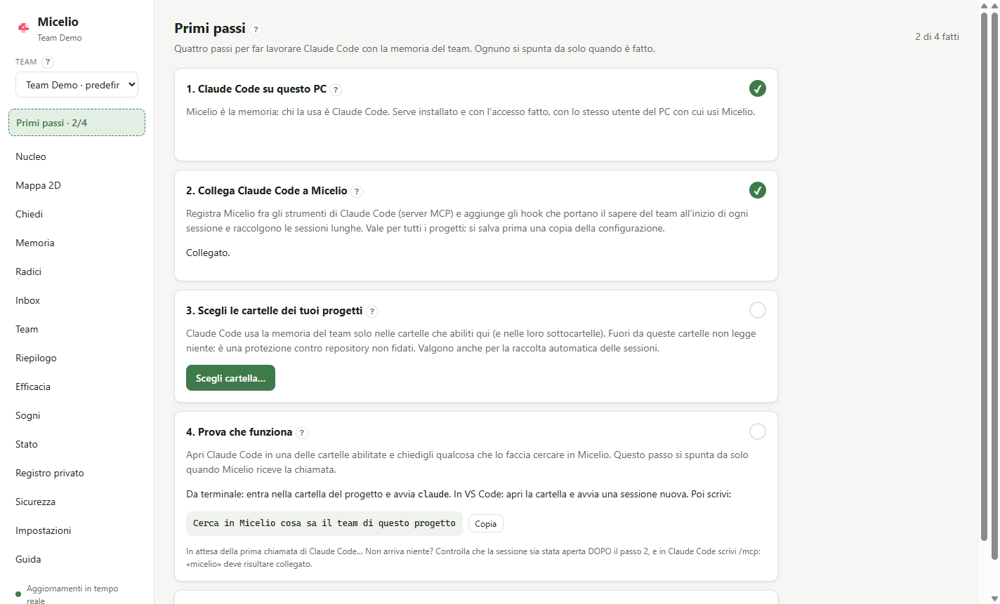

# Guida utente

Micelio è la memoria condivisa del team, pensata per gli assistenti AI. Ogni collega esegue un **nodo** sulla propria macchina. I nodi si sincronizzano tra loro via internet senza server centrale, e ognuno ha una copia completa del sapere del team.

Il sapere entra in due modi: salvataggi espliciti e raccolta automatica dalle sessioni di Claude Code nei progetti che abiliti tu. Prima di arrivare ai colleghi, ogni contenuto passa da un **filtro privacy**.

## Per iniziare

Dall'installazione alla prima risposta di Claude Code con la memoria del team, in sei passi. L'app fa da guida: dopo la creazione del team apre **Primi passi**, che spunta da solo ogni passo fatto.

**Ti serve:** [Claude Code](https://code.claude.com/docs/en/setup) installato e con l'accesso fatto, sullo stesso PC e **con lo stesso utente** con cui userai Micelio. Micelio usa il tuo abbonamento a Claude: nessuna chiave API.



### 1. Installa Micelio

Scarica il pacchetto dall'[ultima release](https://github.com/salvatorestracquadanio86/micelio-second-brain/releases/latest):
- **Windows**: `Micelio-Setup-<versione>.exe`. Non serve essere amministratori. L'installer non è firmato: se Windows mostra «PC protetto da Windows», scegli **Ulteriori informazioni → Esegui comunque**. Alla fine Micelio si apre da solo.
- **Linux**: `Micelio-<versione>-x86_64.AppImage` (qualunque distribuzione: rendilo eseguibile e avvialo) oppure `micelio_<versione>_amd64.deb` (`sudo apt install ./micelio_<versione>_amd64.deb`).

Micelio resta nell'area di notifica anche quando chiudi la finestra: deve restare acceso perché i colleghi ti mandino il sapere e perché Claude Code possa usarlo.

### 2. Crea il team, o entra in quello di un collega

Al primo avvio scegli:
- **Crea un nuovo team**: se sei il primo. Dai un nome al team e il tuo nome, visibile ai colleghi. Diventi admin.
- **Ho un invito**: se un collega ti ha mandato un codice d'invito (lo crea in **Team → Invita un collega**). Incolla il codice e aspetta che il suo Micelio ti accolga: bastano pochi secondi se il suo PC è acceso.

Subito dopo si apre **Primi passi**.

### 3. Collega Claude Code

In Primi passi premi **Collega Claude Code**. Micelio entra fra gli strumenti di Claude Code (server MCP), e Claude Code riceve il sapere del team all'inizio di ogni sessione. È per tutti i tuoi progetti; prima di toccare la configurazione di Claude Code, Micelio ne salva una copia.

**Poi chiudi e riapri le sessioni di Claude Code già aperte** (in VS Code: ricarica la finestra). Claude Code legge i suoi strumenti solo all'avvio.

### 4. Scegli le cartelle dei tuoi progetti

Premi **Scegli cartella…** e indica la cartella di ogni progetto su cui lavori con il team, per esempio `C:\SourceCode\nome-progetto` (valgono anche le sottocartelle; puoi indicare la cartella che li contiene tutti).

È il passo che si dimentica più spesso: **Claude Code usa la memoria del team solo in queste cartelle.** Fuori non legge niente, per sicurezza, e quello che salva finisce nell'Inbox invece che al team.

### 5. Prova che funziona

Apri Claude Code in una delle cartelle abilitate (da terminale: entra nella cartella e avvia `claude`; in VS Code: apri la cartella e avvia una sessione nuova) e scrivi:

> Cerca in Micelio cosa sa il team di questo progetto

In Primi passi, «Prova che funziona» si spunta da solo quando Micelio riceve la chiamata. Con un team nuovo la memoria è vuota: la risposta sarà che non c'è ancora niente, ed è giusto così. Prova anche a salvare: *«ricorda che per questo progetto usiamo …»*. Il ricordo compare nella pagina **Memoria**.

### 6. Invita i colleghi

In **Team → Invita un collega** crea un codice e mandalo al collega: è un segreto, solo per lui. Lui installa Micelio, sceglie **Ho un invito** e segue gli stessi Primi passi.

### Se qualcosa non va

| Cosa vedi | Cosa fare |
|---|---|
| «Claude Code non è installato, o Micelio non lo trova» | Installalo dalla [pagina ufficiale](https://code.claude.com/docs/en/setup), aprilo una volta, fai l'accesso, poi **Ricontrolla** |
| «Questo utente del PC non l'ha mai aperto» | Claude Code si usa con un altro utente di Windows (per esempio un account amministratore): non vedrà mai Micelio. Usa Micelio e Claude Code con lo stesso utente |
| «Prova che funziona» non si spunta | La sessione va aperta **dopo** il collegamento. In Claude Code scrivi `/mcp`: «micelio» deve risultare collegato |
| «Claude Code ha chiamato da una cartella che non è abilitata» | Abilita quella cartella (passo 4 qui sopra), o apri Claude Code in una cartella già abilitata |
| I ricordi salvati da Claude Code finiscono nell'Inbox | Stesso motivo: la cartella della sessione non è abilitata in questo team. Abilitala, poi in Inbox **Pubblica in…** |
| Il codice d'invito resta in attesa | Il PC del collega che l'ha creato deve essere acceso, con Micelio aperto |

Il resto di questa guida spiega ogni funzione nel dettaglio. Dentro l'app, il tasto **F1** o il pulsante **?** aprono la spiegazione della pagina in cui sei.

## 1. Installazione

### Windows: installer

`Micelio-Setup-<versione>.exe` installa tutto per il tuo utente, **senza permessi di amministratore** e **senza bisogno di Node.js** (ne include uno):

1. avvia l'installer. Non è firmato digitalmente: se Windows mostra «PC protetto da Windows», scegli **Ulteriori informazioni → Esegui comunque**;
2. scegli la cartella (default `%LOCALAPPDATA%\Programs\Micelio`) e completa: si apre l'app;
3. crea il tuo team o entra con un invito: si apre **Primi passi**, che ti guida a collegare Claude Code e ad abilitare le cartelle (vedi [Per iniziare](#per-iniziare)).

Il comando `micelio` è disponibile nei terminali aperti **dopo** l'installazione (la cartella `resources\bin` viene aggiunta al PATH dell'utente). I dati restano in `%USERPROFILE%\.micelio`: disinstallare o aggiornare non li tocca. La disinstallazione ferma il daemon e toglie `micelio` dal PATH. Per aggiornare non serve chiudere niente: l'installer ferma il daemon e chiude l'app e i processi di Micelio avviati da Claude Code (dalla 0.6.2 hook e shim non lo riavviano mentre l'installazione è in corso); chiede di chiudere a mano solo se qualcosa resiste.

Se in precedenza usavi Micelio **da sorgente**: ferma quel daemon (`micelio stop`) prima di aprire l'app installata, altrimenti l'app si collega a lui invece di avviare il suo; poi ripeti **Configura** dall'app installata, così gli hook di Claude Code puntano all'installazione e non alla repository.

### Da sorgente (Windows, macOS, Linux)

Requisiti: **Node.js ≥ 22.13** (Windows, macOS o Linux). Per la raccolta automatica serve anche **Claude Code** installato e autenticato: Micelio usa il tuo abbonamento, nessuna API key.

```bash
git clone <repo> micelio && cd micelio
npm ci
npm run build
npm link            # installa il comando `micelio` nel PATH
```

## 1-bis. Lingua

L'app è in italiano e in inglese: si cambia con **IT / EN** in fondo alla barra laterale. Sono due lingue diverse:
- quella dell'**interfaccia**, personale;
- quella dei **ricordi distillati**, di tutto il team, scelta dall'admin nella pagina Team.

## 1-ter. Guida in linea

Dentro l'app, il pulsante **?** accanto ai titoli e il tasto **F1** aprono la spiegazione della pagina o della scheda; la voce **Guida** del menu ha l'indice completo con ricerca. Spiega anche dove stanno fisicamente i dati e come viaggiano.

## 2. Avviare il nodo

```bash
micelio start       # avvia il daemon in background
micelio status      # stato del nodo
micelio stop        # ferma il daemon
```

Il daemon deve restare attivo perché il nodo sincronizzi, perché gli assistenti AI possano usarlo e perché le sessioni vengano raccolte. Si accende in quattro modi:

| Modo | Note |
|---|---|
| `micelio start` | A mano, da terminale |
| App desktop (`npm run desktop`) | Se il daemon è spento, lo avvia lei |
| `micelio autostart on` | **Consigliato.** Lo avvia a ogni accesso al PC, senza privilegi di amministratore: su Windows uno script nascosto nella cartella "Esecuzione automatica", su macOS un LaunchAgent, su Linux un servizio systemd utente. `micelio autostart off` per toglierlo |
| Da solo, a fine sessione | Se una sessione di Claude Code finisce e il daemon è spento, l'hook lo accende (qualche secondo) |

I dati del nodo stanno in `~/.micelio`:

| File / cartella | Contenuto |
|---|---|
| `config.json` | Porta, **token** dell'API locale, impostazioni LLM, cartelle abilitate |
| `state.json` | Chiavi del team. **Contiene la chiave di cifratura: trattalo come una password** |
| `corestore/` | Log replicati del team |
| `view.db` | Indice di ricerca (derivato: si può cancellare, viene ricostruito) |
| `private.db` | **Archivio privato**: inbox, registro delle decisioni, coda, budget. Non lascia mai la macchina |
| `export/` | Copia Markdown in sola lettura del sapere del team |
| `logs/daemon.log`, `logs/hook.log` | Log del daemon e degli errori dell'hook di Claude Code |

Con `--home <cartella>` o la variabile `MICELIO_HOME` si possono tenere più nodi sulla stessa macchina (utile per i test).

## 3. Creare un team (solo la prima volta, una persona)

```bash
micelio init "Team Dev" --name pc-mario
```

Chi crea il team ne è **admin**. Gli admin possono espellere membri, nominare altri admin e cambiare le impostazioni del team. Consiglio: **nomina 2–3 admin** tra chi ha il PC più spesso acceso. Gli admin fanno anche da "garanti" dell'ordine degli eventi (*indexer*).

**Protezione completa (dalla 0.7.0).** I dati del team passano solo fra membri attivi e il contenuto è cifrato con una chiave che cambia da sola quando un admin rimuove qualcuno: chi esce non riceve né legge più niente di nuovo. È accesa nei team nuovi; in un team esistente la accende un admin dalla pagina Team, quando tutti hanno la 0.7.0. Dopo un PC perso: rimuovi il membro e poi «Cambia la chiave adesso».

```bash
micelio members promote pc-lucia
```

## 4. Invitare un collega

**Qualunque membro** può invitare:

```bash
micelio invite
```

Il comando stampa un **codice monouso** valido 24 ore. Mandalo al collega su un canale privato: è un segreto. Il collega esegue:

```bash
micelio start
micelio join <codice> --name pc-lucia
```

- L'ingresso viene accettato da **qualunque membro online**, non per forza da chi ha invitato.
- Se `invite` avvisa che *nessun altro membro online ha ancora ricevuto l'invito*, resta online finché il collega non è entrato.
- Il nuovo membro riceve subito tutto il sapere già accumulato.

`micelio invites` mostra gli inviti non ancora usati.

## 4-bis. Rete: come si trovano i nodi

I PC del team si trovano su internet senza un server centrale:
1. ogni daemon annuncia l'impronta del team, cioè un hash da cui non si risale alla chiave, in una DHT (tabella distribuita);
2. cerca nella DHT gli altri nodi con la stessa impronta;
3. si collega a loro **direttamente**. I router vengono attraversati con l'hole punching: i due PC si contattano nello stesso istante.

Le connessioni sono cifrate e i dati del team lo sono di nuovo con la chiave del team.

| | Quando |
|---|---|
| **DHT pubblica** di Holepunch (default) | Per provare, o se al team va bene che l'impronta del team e gli IP dei membri siano visibili nella DHT pubblica (i contenuti mai) |
| **Server del team** (DHT privata) | Consigliato per un team aziendale: nessuna dipendenza da terzi, all'IT basta aprire una porta UDP su una macchina. Si installa a parte: vedi [server/README.md](../server/README.md) |

```bash
micelio network                          # quale DHT usa questo PC
micelio network set 203.0.113.10:49737   # server del team (tutti i membri devono usare lo stesso)
micelio network public                   # passa alla DHT pubblica (i server privati restano salvati)
micelio network private                  # torna alla DHT privata con i server salvati
micelio network check                    # diagnosi: entra nella DHT? IP pubblico? NAT simmetrico?
```

**Dall'app:** in Impostazioni → **Rete**:
1. scegli *DHT pubblica* o *DHT privata del team*, e per la privata scrivi i nodi di avvio (`host:porta`, uno per riga);
2. **Verifica** prova la scelta senza cambiare nulla e mostra se la rete risponde, l'IP pubblico e il tipo di NAT;
3. **Applica** chiede conferma e la rende attiva subito.

Se il daemon è acceso, la nuova rete vale **subito**, sia dall'app sia dalla CLI: il nodo si ricollega da solo in pochi secondi e i dati locali restano. Se è spento, vale al prossimo avvio.

Il valore sta in `config.json`, in `network.mode` (`public` / `private`) e `network.bootstrap`. Se è impostata la variabile `MICELIO_DHT_BOOTSTRAP` (team demo, container, test), la rete è fissata da lei e l'app lo segnala.

`micelio network check` è la prima cosa da provare se un collega non si collega:
- **"Raggiungibile: NO"**: la rete blocca l'UDP oppure il server è spento o ha la porta chiusa;
- **"NAT simmetrico: SÌ"**: la connessione diretta può fallire con un collega nella stessa situazione. Il sapere arriva comunque se c'è un **nodo sempre acceso** raggiungibile da tutti, che si consiglia di mettere sulla stessa macchina del server.

### Spazio occupato

In **Stato** la scheda *Spazio occupato* mostra:
- **quanto occupa Micelio su questo disco**, diviso fra:
  - log del team;
  - indice di ricerca;
  - archivio privato;
  - documenti scaricati;
  - export;
- **la provenienza del sapere per membro**: una barra colorata e una tabella con la quota del log del team scritta da ciascuno, i byte, i ricordi attivi e il loro testo.

La quota comprende tutto ciò che il membro ha scritto: ricordi, ma anche voti, uso e sogni. È la stessa su ogni PC del team, perché ogni nodo conserva tutto.

## 4-ter. Più team sullo stesso PC

Lo stesso PC può stare in più team (per esempio il team del prodotto e quello di un cliente). Ogni team ha un sapere tutto suo: chiavi, log, ricerca, inbox, cartelle e rete separati. Un agente che lavora per un team non vede i ricordi degli altri.

```bash
micelio init "Cliente X"          # crea un altro team (si aggiunge a quelli che hai)
micelio join <codice>             # oppure entra in un altro team
micelio teams                     # elenco; ★ = predefinito
micelio teams default "Cliente X" # cambia il predefinito
micelio --team "Cliente X" recall "deploy"   # qualunque comando su un altro team
micelio teams leave "Cliente X" --yes        # toglie il team da questo PC
```

- **Il tuo nome** è quello dell'identità personale creata al primo team: non serve ripeterlo. Accanto ai membri, nella pagina Team, vedi se un collega è con te anche in un altro team.
- **Le cartelle** abilitate appartengono a un team solo. Se abiliti `C:\lavoro` nel team A e `C:\lavoro\clienteX` nel team B, le sessioni in `clienteX` vanno solo a B.
- **Gli agenti** cercano nel team che ha abilitato la cartella del progetto; da una cartella che non è in nessun team non leggono la memoria (dalla 0.6.2, protezione contro i repository non fidati). **Salvano** solo nel team della cartella: dalla 0.6.1 un salvataggio da una cartella che non è del team, o non abilitata, o da una sessione con la registrazione vecchia, non viene pubblicato ma va in **Inbox** con il problema e la soluzione, e da lì lo pubblichi nel team giusto con «Pubblica in…». Il daemon aggiorna da solo le registrazioni vecchie di Claude Code all'avvio: riapri le sessioni già aperte.
- **LLM e budget** sono comuni a tutti i team: un solo abbonamento.

Dalla versione con un solo team non serve fare nulla: al primo avvio i file vengono spostati in `~/.micelio/teams/<id>/` e il team diventa il predefinito.

## 5. Il filtro privacy: cosa arriva al team

Ogni contenuto, sia salvato a mano sia raccolto da una sessione, segue lo stesso percorso:

```
contenuto ─▶ filtro locale ─┬─▶ argomento HR/personale ───────────────▶ PRIVATO (resta sul tuo PC)
                            └─▶ segreti oscurati ─▶ classificazione (Claude Haiku)
                                                     ├─▶ tecnico e pulito ─▶ TEAM
                                                     ├─▶ dubbio ───────────▶ INBOX (decidi tu)
                                                     ├─▶ personale ────────▶ PRIVATO
                                                     └─▶ banale ───────────▶ scartato
```

- **Filtro locale.** Gira sul tuo PC *prima* di qualunque chiamata a Claude. Riconosce parole come "valutazione di fine anno", "RAL", "stipendio", "licenziamento", "malattia". Se ne trova una, il contenuto resta privato e non viene inviato a nessun servizio.
- **Segreti oscurati.** Token, chiavi API, password, credenziali negli URL, IBAN, codici fiscali, email e telefoni vengono sostituiti da segnaposto (`[REDACTED:github-token]`) prima di proseguire.
- **Classificazione.** Claude Haiku decide se il contenuto è conoscenza tecnica riutilizzabile. Se non è sicuro, o se il contenuto è misto (tecnico + sensibile), va in **inbox**: nel dubbio non si pubblica.

Sui 22 casi del set di valutazione (`npm run eval:ingest`), tutti gli 8 casi sensibili sono rimasti fuori dal team, compreso un feedback HR scritto senza parole "sospette".

### 5-bis. Segreti e file sensibili

Password, token, chiavi e file come `.env` non entrano mai nel sapere del team.

**Cosa viene tolto:**
- **Segreti nel testo:**
  - chiavi e token di Anthropic, OpenAI, AWS, Azure (chiavi degli account, firme SAS), Google, GitHub, GitLab, npm, PyPI, Slack, Stripe, SendGrid;
  - JWT, header `Authorization`/`Bearer`, chiavi private;
  - password nelle stringhe di connessione e negli URL;
  - variabili come `API_KEY=…` o `"password": …`;
  - stringhe casuali ad **alta entropia** che non hanno un formato noto. Gli hash esadecimali, come i commit, sono esclusi.
- **Dati personali:** IBAN, codici fiscali, email, telefoni.
- **File sensibili**, per intero: `.env` e varianti, chiavi (`*.pem`, `*.key`, `id_rsa`…), `credentials`, `secrets.*`, kubeconfig, `.npmrc`, `.netrc`, `*.tfvars`, `*.tfstate` e simili. Nelle sessioni, se Claude legge, scrive o modifica uno di questi file, anche con un comando come `cat .env`, il contenuto **sparisce dalla trascrizione** prima di qualunque elaborazione; resta solo la nota "contenuto omesso". Nelle cartelle di documenti non vengono aperti. Nel riassunto git compare solo il nome. I file di esempio (`.env.example`, `.env.sample`…) non sono considerati sensibili.

**La schermata Sicurezza** (o `micelio security`) ha quattro parti:
- **Banco di prova:** incolli un testo o scrivi un nome di file e vedi cosa verrebbe tolto, con le regole in vigore (`micelio security test "…"`, `--file <nome>`).
- **Regole del team**, modificabili solo dall'admin e valide subito per tutti:
  - **pattern** di segreti aggiuntivi, per esempio un "codice cliente" interno;
  - **eccezioni** per i falsi positivi, come testo o `/regex/`;
  - **file sensibili** aggiuntivi, come glob.

  I pattern non validi o troppo generici vengono rifiutati.
- **Ricordi da ripulire:** controlla i ricordi già pubblicati con le regole attuali, per esempio dopo aver aggiunto un pattern (`micelio security scan`). Un admin può **ripulirli** (`micelio security clean <id>`): viene pubblicata la versione redatta e l'originale sparisce dalla vista di tutti. Una Radice resta Radice. Limite: chi l'aveva già letto o esportato ne conserva una copia.
- **Registro di questo PC:** cosa è stato tolto, da quale sessione o documento, di che tipo (`micelio security log`). Si registrano solo tipi e nomi dei file, **mai i valori**, e il registro non lascia il PC.

## 6. Salvare e cercare ricordi

```bash
micelio remember "Build Angular in out of memory su Azure DevOps" \
  --kind gotcha --tags angular,ci \
  --body "Impostare NODE_OPTIONS=--max-old-space-size=6144 nello step di build."

echo "contenuto lungo..." | micelio remember "Titolo"     # corpo da stdin

micelio recall angular memoria build
micelio get c297bc9dc2d1                                  # id anche abbreviato
```

`remember` risponde con uno di tre esiti:

| Esito | Significato |
|---|---|
| `✔ Pubblicato nel team` | Mostra il testo esatto pubblicato, già ripulito dai segreti |
| `⏸ In inbox` | Serve una tua decisione (vedi §8) |
| `🔒 Non pubblicato, trattenuto come privato` | Con il motivo |

Tipi di ricordo (`--kind`): `fact`, `howto`, `decision`, `gotcha`, `snippet`, `reference`.

**Cosa salvare:** conoscenza tecnica riutilizzabile, cioè soluzioni verificate, decisioni con il loro *perché*, gotcha e procedure. Tutto ciò che arriva al team arriva a **tutti** e **non si può cancellare** dalle loro macchine.

La cartella `~/.micelio/export/team/` contiene un file Markdown per ricordo, comodo da sfogliare (anche con Obsidian). È in sola lettura e viene rigenerata.

## 7. Raccolta automatica dalle sessioni di Claude Code

È **opt-in per progetto**: Micelio guarda solo le sessioni avviate nelle cartelle che abiliti.

```bash
micelio setup claude-code           # una volta: registra MCP e l'hook di fine sessione
micelio watch add C:\progetti\ordini # abilita un progetto (e le sue sottocartelle)
micelio watch                        # elenco delle cartelle abilitate
micelio watch remove C:\progetti\ordini
```

Quando chiudi una sessione di Claude Code in una cartella abilitata, l'hook avvisa il daemon. La sessione passa dal filtro privacy (§5) e, se è tecnica, Claude Sonnet ne **distilla** da 0 a 5 ricordi atomici, pubblicati nel team.

**Sessioni lunghe (anche di giorni) e sessioni perse:** il daemon controlla le trascrizioni di Claude Code anche **mentre la sessione è aperta**:
- **quando:** all'avvio, poi ogni 15 minuti, oppure subito con `micelio ingest scan`;
- **cosa distilla:** la **parte nuova** di una sessione in **pausa da almeno 10 minuti** con abbastanza contenuto (4 tuoi messaggi o 6.000 caratteri). Una sessione ferma da più di 6 ore viene presa in ogni caso;
- **niente doppioni:** ogni parte viene distillata **una sola volta**, che arrivi da qui o dall'hook;
- **cosa ignora:** il prompt di distillazione lascia fuori i tentativi ancora aperti;
- **recupero:** le sessioni finite mentre il daemon era spento vengono recuperate al primo avvio. Anche quelle aperte prima di `micelio setup` vengono raccolte.

Le soglie si cambiano in `config.json`, in `watch.sessionScan`: `intervalMinutes`, `idleMinutes`, `minUserTurns`, `minChars`, `staleHours`, `enabled`.
**Modifiche al codice:** se il progetto è un repository git, Micelio aggiunge al materiale da distillare un riassunto di cosa è cambiato durante quel pezzo di sessione:
- i commit, con hash e messaggio;
- il lavoro non ancora committato;
- i file nuovi, modificati o eliminati, con le classi, le funzioni e gli endpoint aggiunti o rimossi.

**Riferimenti per approfondire:** ogni ricordo nato da una sessione di codice porta con sé progetto, branch, repository, file, simboli e commit coinvolti. Li vedi:
- nell'app, nel riquadro «Dal codice» del ricordo. Se il repository è su GitHub, GitLab o Azure DevOps, i commit sono link;
- con `micelio get <id>` (tutti) e `micelio recall` (forma breve);
- negli agenti, nei risultati MCP: se lavorano sullo stesso progetto possono aprire i file o fare `git show <commit>`;
- nell'export Markdown, sotto il titolo; il progetto compare anche nel frontmatter.

I commit vengono verificati su git, quindi un hash inventato dal modello viene scartato. I percorsi sono sempre relativi al repository, mai quelli del tuo disco.

Così nascono ricordi come «Aggiunto `OrderService` in `src/orders` (commit `1a2b3c4d`): centralizza la conferma degli ordini, prima sparsa nei controller». Il codice non viene copiato: passano solo nomi e messaggi, e anche questi attraversano il filtro privacy. Per disattivarlo: `"gitChanges": false` in `watch` dentro `config.json`.

- **Fedeltà alla fonte:** la distillazione riporta solo ciò che è stato detto o dimostrato nella sessione, senza aggiunte.
- **Sessioni brevi:** quelle che non insegnano nulla non producono ricordi.
- **Sessioni riprese:** se riprendi una sessione, viene elaborata solo la parte nuova.

```bash
micelio ingest status     # LLM disponibile? budget di oggi, coda, inbox
micelio ingest run        # elabora subito il prossimo lavoro in coda
```

`micelio setup claude-code` modifica `~/.claude/settings.json` e ne salva prima una copia (`settings.json.micelio-backup`). Con `--no-hook` registra solo MCP, senza raccolta automatica.

### Budget e modelli

Ogni sessione elaborata costa 2 chiamate a Claude (classificazione + distillazione); ogni salvataggio esplicito 1. Il default è **300 chiamate al giorno per nodo**. Quando finiscono, il lavoro resta in coda per il giorno dopo e non si perde. Si cambia in `~/.micelio/config.json`:

```jsonc
"llm": {
  "adapter": "claude",        // "none" = niente LLM: i casi dubbi vanno tutti in inbox
  "classifyModel": "haiku",
  "distillModel": "sonnet",
  "dailyBudget": 300
}
```

(dopo una modifica: `micelio stop && micelio start`)

### Quanti ricordi per sessione

Il distillatore estrae **al massimo 5 ricordi** per sessione (o per parte di documento), dal più importante al meno importante. È una scelta contro il **rumore**, non un limite di costo: con la CLI dell'abbonamento le chiamate non si pagano una a una, ma una memoria piena di ricordi marginali è più difficile da usare, per le persone e per gli agenti.

Il limite è un'**impostazione di team** che sceglie l'**admin**, da 1 a 20: pagina **Team**, oppure `micelio team config distill.maxMemories 8`. Per decidere con i dati c'è la scheda **Qualità della distillazione**, anche da terminale con `micelio quality`. Per ogni **posizione** nel distillato (1ª, 2ª, 3ª, 4ª–5ª…) mostra:
- quanti ricordi si sono rivelati **utili**: votati positivamente o usati dagli agenti;
- quanti sono stati **votati inutili**;
- quanti sono stati **fusi o archiviati** dal dreaming, cioè doppioni o sapere che non serviva;
- quanti non sono **mai stati usati**;
- un **punteggio** da −1 a +1.

Mostra anche quante distillazioni **raggiungono il limite**: se succede spesso, il limite sta tagliando. Valgono solo i ricordi con più di 3 giorni, che hanno avuto il tempo di essere usati.

In fondo c'è un'**indicazione**:
- **alzare**, se le ultime posizioni valgono quasi quanto le prime e il limite viene raggiunto spesso;
- **abbassare**, se le ultime posizioni sono spesso inutili o fuse;
- **tenere**;
- **dati insufficienti**, sotto i 30 ricordi maturi.

## 7-bis. Cartelle di documenti

Micelio può leggere anche i documenti del team: PDF, Word, Excel, PowerPoint, OpenDocument, RTF, Markdown, testo.

```bash
micelio docs add C:\documenti\architettura --shareable   # i colleghi potranno scaricare gli originali
micelio docs add C:\documenti\appunti                    # solo distillato: gli originali restano qui
micelio docs                                              # cartelle e conteggi (elaborati, in coda, bloccati…)
micelio docs remove C:\documenti\appunti
```

- **Elaborazione:** ogni documento nuovo o modificato passa dallo stesso filtro privacy delle sessioni ed è distillato in ricordi. Un documento invariato non viene mai rielaborato, nemmeno dopo un riavvio.
- **Cartelle protette:** i documenti in cartelle come `HR`, `contratti`, `buste paga`, `valutazioni`, `candidati` o `privato` **non vengono nemmeno aperti**: restano privati e il motivo compare in `micelio private`. Gli admin possono aggiungere altri percorsi con `micelio team config filter.blockedPaths '["**/clienti/acme/**"]'`.
- **Documenti molto lunghi:** vengono distillati a parti, fino a 6 parti da circa 12.000 caratteri ciascuna.
- **Limiti:** i file oltre 20 MB e quelli protetti da password vengono saltati.

Anche dall'app: **Impostazioni → Cartelle di documenti**.

### Scaricare il documento originale

Al team arriva solo il distillato. Se serve approfondire, dal ricordo si può chiedere l'**originale**:

```bash
micelio fetch 8ea1102f047d      # id del ricordo
```

- **Da dove arriva:** dal PC del collega che possiede il documento. Quel PC deve essere acceso, e la cartella deve essere stata aggiunta con `--shareable`.
- **Dove finisce:** in `~/.micelio/sources/` e resta lì 30 giorni. Le copie scaricate non vengono mai ripassate ad altri: se cambi idea su una cartella, nessuna copia continua a circolare.
- **Verifiche:** chi chiede deve essere un membro attivo del team, e il file ricevuto viene controllato con la sua impronta (hash). Un collega non può mandarti un contenuto diverso.

Dall'app c'è il pulsante **Scarica l'originale** nel dettaglio del ricordo. Da Claude Code: *"scarica il documento originale di questo ricordo"* (tool `fetch_source`).

## 7-ter. Priorità: quali ricordi contano di più

Ogni ricordo ha un'**attivazione** da 0 a 100%, che dice quanto è "vivo" per il team. Cresce con:
- **uso recente:** ogni ricordo restituito da una ricerca conta come uso; i conteggi di tutti i colleghi si sommano;
- **voti di utilità;**
- **collegamenti con altri ricordi.**

Decade lentamente se nessuno lo usa. Una decisione decade più lentamente di uno snippet. Un ricordo **fissato** resta sempre al 100%.

```bash
micelio vote c297bc9dc2d1 up      # utile        (down = fuorviante o obsoleto, clear = ritira il voto)
micelio pin c297bc9dc2d1          # fissa: non decade e il dreaming non lo archivierà
micelio unpin c297bc9dc2d1
```

La ricerca (`recall`, app, Claude) è **ibrida**:
- trova i ricordi sia per parole sia per significato. Per esempio *"la build va in memoria esaurita"* trova *"out of memory nella pipeline"*, anche fra lingue diverse;
- a parità di pertinenza mette prima quelli con attivazione più alta.

Il calcolo dei significati (embedding) avviene sul tuo PC, senza servizi esterni. Al primo uso scarica un modello di circa 130 MB in `~/.cache/micelio-models`, condiviso da tutti i nodi della macchina. Per disattivarlo: `"embeddings": { "adapter": "none" }` in `config.json`.

Nell'app: attivazione, usi, 👍 👎 e 📌 nel dettaglio di ogni ricordo. Nel Nucleo i ricordi più vivi sono le stelle più grandi e dorate.

## 7-ter-bis. Radici: il sapere che non si dimentica

Alcuni ricordi sono **pilastri** del team: paradigmi architetturali, mappe di rete, interfacce e contratti fra sistemi, modello di dominio, best practice (per esempio le regole di sviluppo con l'AI), policy di sicurezza. Si consultano di rado, magari ogni volta che si progetta un pezzo nuovo, e poi non si riaprono per mesi. Con la sola priorità basata sull'uso finirebbero dimenticati. Per questo esistono le **Radici**.

**Cosa cambia per una Radice:**
- **Non si dimentica:** non decade mai, il dreaming non la archivia e non la fonde, e la sua priorità non scende sotto una soglia minima.
- **Arriva quando serve:** ogni ricerca degli agenti (`recall`) riceve in coda le **Radici pertinenti**, anche quando non sono fra i primi risultati. Il tool MCP `architecture` dà le Radici di un progetto, di una categoria o dei file che si stanno toccando, e gli agenti sono istruiti a chiamarlo prima di modificare l'architettura.
- **Si rivede invece di dimenticarla:** vedi sotto.

**Categorie:** architettura, rete e infrastruttura, interfacce e contratti, dominio, best practice, policy, altro.

**Come nasce una Radice.** **Chiunque** nel team può promuovere o togliere una Radice:
- **dall'app:** nel dettaglio di un ricordo (Memoria, Nucleo, Mappa) scegli la categoria e premi **Rendi Radice**;
- **da terminale:**

```bash
micelio roots add <id> architecture
micelio roots remove <id>
micelio roots                              # elenco per categoria (anche: --project, --category, --query)
```

- **dalla CLI di Claude:** chiedendolo all'agente, che usa il tool `mark_root`;
- **suggerite da Micelio:** il distillatore segnala i ricordi che sembrano sapere fondante. Restano solo **suggerimenti**, nella vista Radici o con `micelio roots suggested`: le promuovi tu con un clic o le ignori;
- **cartelle "di Radici":** marcando una cartella di documenti come *di Radici* (Impostazioni, o `micelio docs add <cartella> --roots`), i ricordi dei suoi documenti diventano Radici da soli. Va bene per la cartella dell'architettura, delle policy o il vault delle regole. Da quelle cartelle si leggono anche i **diagrammi**: draw.io, SVG, PlantUML e Mermaid.

**Revisione (lanciata a mano, nessun promemoria automatico).** Una Radice che non decade può diventare *falsa* senza che nessuno se ne accorga. Con **Rivedi le Radici** (vista Radici) o `micelio roots review`, Micelio cerca tre tipi di indizi:
- **codice cambiato:** commit successivi all'ultima revisione sui file citati dalla Radice, o file non più presenti. Il repository del progetto viene cercato fra le cartelle abilitate su **questo** PC e le loro sotto-cartelle;
- **documento d'origine cambiato o rimosso:** si verifica solo sul PC che possiede il documento;
- **contraddizioni:** ricordi più recenti e simili che la contraddicono o la superano. Le cerca Claude, con al massimo 30 confronti per revisione ed entro il budget.

Le Radici con indizi diventano **"da rivedere"** per tutto il team, con i motivi. Dopo averle controllate:
- se è ancora valida, **Rivista: è ancora valida** (`micelio roots confirm <id>`);
- se non lo è, correggi il ricordo o togli la Radice.

Nulla cambia da solo. Il resoconto dice anche cosa non è stato possibile verificare da questo PC.

**Nelle viste grafiche:**
- **Nucleo 3D:** le Radici stanno **al centro della sfera**, con un **anello** bianco (rosso se da rivedere).
- **Mappa 2D:** sono **rombi** con contorno.
- **In entrambe:** **◆ Radici** isola solo le Radici.

## 7-quater. Dreaming: il sapere si riordina da solo

Una volta al giorno **un** nodo del team "sogna" per tutti. Di default dalle 13; se quel nodo è spento o non ha Claude, tocca al successivo 30 minuti dopo, e così via. Il sogno:

- **fonde** i ricordi quasi uguali, scritti magari da colleghi diversi, in uno solo;
- **archivia** quelli superati da ricordi più recenti (per esempio una decisione cambiata);
- **collega** quelli correlati: i legami del dreaming sono le sinapsi dorate nel Nucleo;
- lascia **decadere** quelli che nessuno usa più da mesi (attivazione sotto il 15%, più di 90 giorni);
- scrive un **diario** di cosa ha fatto.

Niente viene cancellato: fusi e archiviati restano nell'**archivio** e si ripristinano. I ricordi **fissati** non vengono mai toccati. Ogni sogno usa al massimo 30 chiamate a Claude.

```bash
micelio dream now          # sogna subito su questo nodo
micelio dream log          # diario dei sogni del team
micelio archive            # ricordi archiviati o sostituiti
micelio restore <id>       # ripristina
```

Nell'app: schermata **Sogni**, con diario, "Sogna ora" e archivio con "Ripristina". Per non far mai sognare il tuo PC: `"dream": { "enabled": false }` in `config.json`.


## 7-quinquies. Agenti più informati, sapere più pulito

**Contesto automatico.** Con `micelio setup claude-code` Claude Code riceve da solo, a inizio sessione, le Radici e i ricordi più utili del progetto della cartella, e a ogni richiesta i ricordi pertinenti (solo se lo sono davvero). Si regola in Impostazioni → «Contesto automatico»; `--no-context` non installa gli hook.

**File per gli agenti.** `micelio roots export <cartella> --format claude` (o `agents`, `cursor`) scrive le Radici nel file che l'agente legge a ogni sessione e lo tiene aggiornato; il resto del file non si tocca. `micelio roots import docs/adr` trasforma ADR, CLAUDE.md o note Markdown in Radici.

**Aggiornare invece di aggiungere.** Un ricordo che corregge uno esistente lo sostituisce con una versione unica (la vecchia resta nello storico). L'admin può spegnerlo dalla pagina Team.

**Codice cambiato.** I ricordi che citano file modificati dopo la loro scrittura scendono nella ricerca e mostrano un avviso, anche agli agenti. `micelio stale --check` li elenca.

**Lacune e riepilogo.** Le ricerche senza risposta si vedono in Riepilogo (`micelio gaps mine`) e si segnalano al team (`micelio gaps report`). `micelio digest` mostra la settimana del team.

**Da soli.** `micelio init <nome> --solo` crea un team senza rete; `micelio remember … --personal` salva un ricordo che resta solo sul tuo PC (`micelio personal` per vederli, condividerli o cancellarli).

## 8. Inbox: i casi dubbi

L'inbox contiene **solo** ciò su cui il filtro non ha potuto decidere da solo. I contenuti puliti vanno al team senza chiederti nulla, quelli chiaramente personali restano privati. L'inbox è locale: nessun collega la vede.

```bash
micelio inbox                                         # elenco con motivo e scadenza
micelio inbox approve 3f2a9c1e                        # pubblica così com'è
micelio inbox approve 3f2a9c1e --title "…" --body "…" # pubblica correggendo (es. togliendo un dettaglio)
micelio inbox reject 3f2a9c1e                         # scarta
```

Gli elementi non decisi scadono dopo **14 giorni**. Anche da Claude Code puoi chiedere *"cosa c'è nella mia inbox di Micelio?"*: Claude usa i tool `inbox_review` e `inbox_decide`, sempre dopo una tua decisione esplicita.

## 9. Registro privato

```bash
micelio private
```

Mostra cosa **non** è andato al team e perché: bloccato dal filtro, privato, scartato, rifiutato da te, scaduto. È solo sul tuo PC.

## 10. Impostazioni del team (solo admin)

Si replicano a tutti i nodi:

```bash
micelio team config memory.language en                                  # lingua dei ricordi distillati (default it)
micelio team config filter.blockKeywords '["progetto riservato","NDA"]'  # parole che bloccano, oltre a quelle di default
```

## 11. Usarlo da Claude Code

Dopo `micelio setup claude-code`, in qualunque sessione:

- *"Cerca nella memoria del team se abbiamo già risolto l'out of memory della build."*
- *"Salva nella memoria del team questa decisione: …"*

Claude ti mostra sempre il testo salvato a tuo nome, oppure ti dice che è finito in inbox o nel privato. Per far consultare la memoria in automatico, aggiungi al `CLAUDE.md` dei progetti una riga come:

```
Prima di task non banali cerca nella memoria del team con il tool micelio recall.
```

Dettagli sui tool e sugli altri client: [mcp.md](mcp.md).

## 12. Membri ed espulsioni

```bash
micelio members                 # albero degli inviti: chi ha invitato chi
micelio members remove pc-x     # solo admin
```

### Redazione (solo admin)

Se un dato sensibile è arrivato al team per errore:

```bash
micelio redact <id> --reason "conteneva un dato di un cliente"
```

Titolo e contenuto spariscono dalla vista di tutti i nodi e il ricordo non si può ripristinare.

Dalla 0.6.0 ogni PC, appena riceve la redazione, toglie il ricordo anche da risposte della chat, Inbox e copie personali e lo **conferma** (con una firma, se ha un'identità personale). Chi ha confermato e la ricevuta da consegnare, per esempio a un cliente:

```bash
micelio redactions                 # elenco, con quanti PC hanno confermato
micelio redactions <id>            # ricevuta leggibile
micelio redactions <id> --json     # ricevuta con le firme verificabili
```

La stessa cosa si vede in **Sicurezza → Redazioni**. I backup automatici fatti prima della redazione non si toccano: la ricevuta dice quanti ne restano su ogni PC.

**Limite:** chi l'aveva già letto, esportato o scaricato ne conserva una copia, e i blocchi cifrati restano nei log replicati. Per questo la difesa principale resta il filtro in ingresso.

### Metriche

`micelio metrics` (o `GET /api/metrics`) restituisce in JSON:
- uptime e memoria del processo;
- peer, membri, ricordi e archiviati;
- inbox, coda e documenti;
- chiamate LLM di oggi e numero di sogni.

Utile per la diagnostica o per un monitoraggio esterno.

### Espulsioni

Un membro espulso non può più scrivere nel team. **Limite intrinseco:** ciò che aveva già ricevuto resta sulla sua macchina. La rotazione della chiave per proteggere il sapere futuro è prevista in Fase 7.

## 13. Risoluzione problemi

| Sintomo | Causa probabile |
|---|---|
| `Il daemon Micelio non risponde` | Il daemon non è avviato: `micelio start`. Se non parte, guarda `~/.micelio/logs/daemon.log` |
| `join` va in timeout | Nessun membro del team è online, oppure l'invito non è ancora arrivato a nessun membro online. Riprova quando qualcuno è acceso |
| `Peer: 0 connessi` a lungo | Nessun altro membro online, oppure la rete blocca UDP, oppure i PC usano DHT diverse. Controlla con `micelio network` (stessa DHT su tutti?) e `micelio network check` (§4-bis) |
| Le sessioni di Claude Code non vengono raccolte | La cartella è abilitata (`micelio watch`)? Il daemon è attivo? Errori dell'hook in `~/.micelio/logs/hook.log`; sessioni ignorate segnalate in `daemon.log` |
| `ingest status` dice LLM "NON disponibile" | Claude Code non è stato trovato (né nel PATH né nelle installazioni note, estensione di VS Code compresa) o non è autenticato. Imposta `llm.command` in `config.json` con il percorso completo di `claude` |
| Tutto finisce in inbox | Budget esaurito o LLM non disponibile (nel dubbio non si pubblica): controlla `micelio ingest status` |
| Porta 7337 occupata | Imposta `"port"` in `~/.micelio/config.json`, poi riesegui `micelio setup claude-code` |
| Claude Code non vede i tool (Micelio assente in `/mcp`) | Premi «Collega Claude Code» in Impostazioni e leggi il messaggio, poi chiudi e riapri la sessione. Se compare l'avviso sull'utente, Claude Code gira con un altro utente del sistema: apri Micelio con quello stesso utente. Il daemon deve essere attivo. Verifica con `claude mcp list` |
